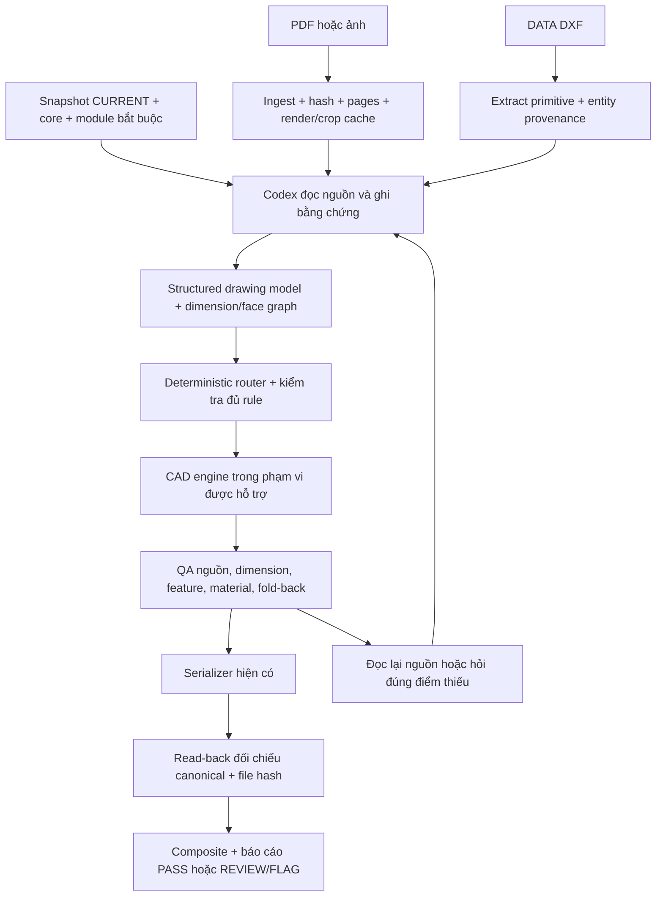

# Plan: TrainAiCad MCP chạy thật từ bản vẽ đến DXF có QA

Ngày: 2026-09-30. Trạng thái: **kế hoạch, chưa triển khai**.

## 1. Mục tiêu và phạm vi đã xác nhận

Người dùng chọn: **Codex/ChatGPT đọc bản vẽ rồi gọi MCP; chưa cần API Vision riêng**. Môi trường nghiệm thu đầu tiên là **Codex trên máy Windows hiện tại**, kết nối MCP loopback. Khả năng truy cập localhost từ client ChatGPT khác phải được kiểm chứng riêng; không mặc định ChatGPT web gọi được server trên máy.

Đầu ra cần đạt: nhận PDF/ảnh và DATA DXF khi có; Codex nhận được ảnh nguồn thật, diễn giải với bằng chứng; MCP kiểm tra ràng buộc, dựng hình học, xuất một composite DXF, đọc lại file, đối chiếu nguồn/canonical/output và trả trạng thái trung thực. Người vận hành không phải tự viết tọa độ hoặc tự điền QA PASS để demo chạy.

Không thêm Jev, API Vision riêng, vector database, cloud/public deployment ở mốc đầu. Giữ Jev disabled. Rules/regression đã duyệt vẫn theo CURRENT; không sửa production lesson, historical release hoặc tự push/merge.

Phân biệt ba mức hoàn thành:

1. **Runtime E2E đạt:** transport, lưu job, chạy engine, xuất/đọc file hoạt động với fixture. Không chứng nhận hiểu bản vẽ.
2. **Source E2E đạt trong phạm vi hỗ trợ:** Codex đọc nguồn thật, tạo evidence, engine/QA thực thi và kết quả khớp kiểm chứng độc lập; không hardcode đáp án vào agent/engine.
3. **Production acceptance theo phạm vi:** cả test âm, positive canary và QA của từng job đạt. Không suy rộng từ plate sang mọi L/U/BOXMET hay từ vài canary sang mọi khách hàng.

## 2. Baseline đã kiểm chứng

- Repo: `F:\AI\TrainAiCad`, remote `https://github.com/GoldDRauDen/TrainAiCad.git`.
- HEAD và origin/main sau fetch khi lập plan: `65ac146b32d3c7ac4b91c07266b1b77d530fe98c`.
- CURRENT: V4.22; MCP: V0.3.0. Snapshot phải được lấy lại trước khi bắt đầu implementation nếu remote thay đổi.
- Kết quả review trước: 33 MCP tests và 77 Python tests đạt; HTTP initialize/list 8 tool và fixture export/read-back đã chạy thật.
- Probe đã chứng minh 5 nhóm lỗi: sai Ø vẫn PASS; mất notch/feature trong linear chain; xóa hole sau export vẫn PASS; structural-only fold-back được caller nâng thành PASS; descriptor nguồn và binding khác SHA sau PASS.
- Bằng chứng: `LUAN/review-mcp-20260930/REVIEW.md`, `probe-results.json`, `verify.mjs`.
- `tools/export_dxf.py` **đã** so fingerprint trước/sau save và kiểm tra packaging. Không viết lại serializer chỉ để làm cùng việc. `audit_dxf` gọi lại sau đó đang thiếu expected canonical/payload để đối chiếu file hiện tại.
- `feature/trainaicad-mcp-v1` có phần compare/review/unfold riêng, chưa được review và chưa merge main. Chỉ tái sử dụng sau khi đọc diff và chạy test âm; không coi tên V1 là chứng nhận.

## 3. Kiến trúc mục tiêu và ranh giới trách nhiệm



MCP bao ngoài các thao tác trên. Host giữ phần nhận thức hình ảnh; service quản lý trạng thái, ràng buộc, tính toán và kiểm tra. Mandatory rule loader dùng đường dẫn/ID/dependency rõ ràng. Tìm kiếm bổ sung trong rule/regression có thể thêm sau; kết quả tìm kiếm không được loại bớt core bắt buộc.

**Giới hạn phải ghi rõ:** schema hợp lệ, một crop đã trả về, hoặc model ghi PROVED không tự chứng minh model nhìn/hiểu đúng. Lưu nguồn của từng claim; tách `source_review_claim` khỏi `machine_check_result`. Agent phải thực sự nhận ảnh và kiểm tra chứng cứ; service chỉ đánh dấu machine PASS cho kiểm tra thực thi được. Mơ hồ còn ảnh hưởng sản xuất phải REVIEW/FLAG, không đổi thành confidence threshold.

## 4. Phạm vi hỗ trợ theo mốc

| Mốc | Được nghiệm thu | Chưa được suy ra |
|---|---|---|
| A — chặn PASS sai | 5 nhóm lỗi cũ bị từ chối, lưu lý do/canonical đã chứng minh | Chưa có production E2E |
| B — plate | Một code plate thật: contour có notch, hole/slot/marking trong tập được hỗ trợ, material rules áp dụng đủ | Không mặc định mọi curve/entity của DXF đều hỗ trợ |
| C — nguồn và composite | PDF+DATA bảo toàn geometry, đa code, pending/preview/review, restart/retry | DATA với entity/transform chưa hỗ trợ phải báo đúng phạm vi |
| D — bend | L rồi U với face transforms, Nobi, bend-domain, feature, fold-back thực | BOXMET, acute, mixed-axis chưa được PASS đến khi có capability/test riêng |
| E — vận hành | Fresh install, Codex gọi tool thật, source E2E và release report | Không đồng nghĩa headless hoặc public service |

Danh sách khả năng phải là dữ liệu có phiên bản: topology, feature family, primitive, transform, QA đã triển khai. Chỉ dùng `UNSUPPORTED_CAPABILITY` khi thật sự chưa hỗ trợ; không nhầm với thiếu bằng chứng nguồn. Giữ geometry đã chứng minh; không thay bằng bbox để vượt gate.

## 5. Các bước thực hiện và điều kiện qua cổng

Thực hiện tuần tự theo phụ thuộc dưới đây. Mỗi mục nhỏ là một work packet hướng tới 1–4 giờ; đây là cách chia việc, **không phải cam kết thời gian**. Nếu một packet vượt phạm vi, tách tiếp và cập nhật plan trước khi mở rộng. Mỗi packet có commit/test riêng trên nhánh triển khai, không tự publish.

### M0 — Chốt snapshot, fixture và baseline

- [ ] **0.1** Safe-sync và lập snapshot gồm commit, entrypoint/CURRENT/core/module/reference hashes. Đọc đầy đủ portable và dependencies trước khi triển khai logic engineering; đối chiếu các giới hạn preview trong `tools/DXF_INPUT_SCHEMA.md` với CURRENT, ghi conflict nếu thực sự có.
- [ ] **0.2** Tạo `tests/fixtures/catalog.json` chứa mode, đường dẫn/hash, role, approval provenance, phạm vi kỳ vọng của mỗi fixture; tách fixture tổng hợp và nguồn thật. Không tự suy tên `_ss`, `_mau`, `_ALL` thành reference đã duyệt.
- [ ] **0.3** Đưa 5 probe hiện có thành assertion test âm; chạy trên baseline để thấy đúng lỗi dự kiến. Lưu baseline log; không bắt exception chung rồi coi test đạt.
- [ ] **0.4** Review phần tương ứng trên V1, ghi quyết định reuse/reject cho compare/review/geometry. Không merge cả nhánh để tránh kéo lùi rule hoặc mang theo lỗi chưa kiểm chứng.

Files: thêm `services/trainaicad-mcp/tests/production_gate.test.ts`, `tests/fixtures/catalog.json`, `scripts/run-e2e.mjs`; tham chiếu report/probe hiện có; không sửa fixture gốc.

**Gate M0:** snapshot và inventory rõ; baseline reproducible; test âm có expected failure cụ thể. Fixture thật thiếu binary/approval phải ghi `SOURCE_UNAVAILABLE`/`REFERENCE_UNVERIFIED`, không skip rồi gọi đó là source E2E PASS.

### M1 — Chặn cấp PASS sai và khóa trạng thái

- [ ] **1.1** Bỏ quyền caller quyết định kết quả manufacturing QA. `export_dxf` dùng QA record do service tạo và gắn `source/evidence/geometry/ruleSnapshot/engineVersion` hashes; input QA cũ chỉ lưu dạng claim hoặc trả lỗi migration rõ ràng.
- [ ] **1.2** Nếu validator cần thiết chưa có, không cấp production QA. Canonical `STRUCTURAL_ONLY_V02` không được cấp production export/PASS bằng `foldBack: PASS` từ client.
- [ ] **1.3** Mọi builder kiểm tra feature inventory/count/cancelled/extra/duplicate IDs; đối chiếu dimension với geometry. Trước khi có transform đúng, linear chain có feature hoặc nonrectangular face phải bị chặn, không tự bỏ feature/notch.
- [ ] **1.4** Trạng thái lỗi/retry được lưu nhất quán. Sửa evidence/geometry tạo revision mới, vô hiệu QA/output cũ; không để lỗi ở giữa các transition tạo đường tắt PASS. Job cũ đã PASS cần revalidation trước khi xuất lại qua runtime mới, không tự xóa file cũ.

Files: sửa `src/core.ts`, `model.ts`, `geometry.ts`, `dxf.ts`, `server.ts`; thêm `src/qa.ts`, `tests/production_gate.test.ts`, `tests/state.test.ts`.

**Gate M1:** sai Ø, mất hole/notch, QA tự khai, structural-only đều bị chặn và có error code rõ; happy-path fixture chỉ PASS khi các validator thật đã tồn tại. Ở mốc này việc chưa có production positive là chấp nhận được, không làm yếu gate để test xanh.

### M2 — Nguồn, rule snapshot và ảnh thật đến host

- [ ] **2.1** `open_cad_job` tham chiếu source đã ingest/xác minh. Descriptor và binding chỉ có một identity theo role+SHA. Binding khác SHA sau evidence bị từ chối trước mutation; idempotent khi cùng nguồn.
- [ ] **2.2** Thêm nhận file local trong thư mục được cấu hình rõ; resolve đường dẫn thật, chặn traversal/symlink ra ngoài, áp size/type/hash validation hiện có. Không cho caller tùy ý đọc toàn filesystem.
- [ ] **2.3** PDF bridge lấy page count, text/vector nếu có, render overview, crop theo câu hỏi; cache theo SHA/page/region/DPI/rotation. PDF hỏng/page không tồn tại phải lỗi. Chốt thư viện render và version sau smoke trên Windows/Linux; không giả định `ezdxf` đọc PDF.
- [ ] **2.4** MCP trả image content thực hoặc resource mà host đã chứng minh nhận được ảnh, không chỉ path. Lưu crop metadata và receipt ở host adapter; receipt không tự được dùng làm semantic PASS.
- [ ] **2.5** Rule loader resolve CURRENT + core + applicable modules và refs thành immutable snapshot. Trả đầy đủ nội dung cần đọc cho host, hashes/IDs cho service. Thiếu file, conflict hoặc changed snapshot giữa job phải block hoặc dùng snapshot bất biến đã lưu, không âm thầm đổi rule.
- [ ] **2.6** Source census gồm document/page/code order và inventory view/family. Tách source mode trước geometry; 646 thiếu DATA trả `DATA_REQUIRED_MISSING`. Pending/revision/cancellation phải biểu diễn được.

Files: sửa `src/ingest.ts`, `core.ts`, `model.ts`, `server.ts`; thêm `src/source_views.ts`, `src/rules.ts`, `bridge/pdf_bridge.py`, `config/capabilities.json`, `tests/source.test.ts`, `tests/rules.test.ts`, `tests/test_mcp_pdf_bridge.py`; sửa dependencies nếu cần.

Tool/API đề xuất, chưa tồn tại: `get_cad_source_view`, `get_cad_rule_bundle`. Ingest local có thể mở rộng tool hiện tại bằng input union rõ ràng; giữ giới hạn role và compatibility.

**Gate M2:** host thấy đúng trang/crop test; test source SHA mismatch, role confusion, 646 missing DATA và mandatory module missing đều chặn; restart không đổi identity/snapshot. Render/page coverage có log thật, không phải câu tự khai do script viết.

### M3 — Evidence contract và một plate chạy đúng end-to-end

- [ ] **3.1** Versioned evidence schema: source anchors, view/face/frame, witness endpoints, dimension class, exact printed token+unit, derived expression/rule ID, feature family/count/status. Không `eval` công thức từ client; dùng expression AST/operator allowlist.
- [ ] **3.2** Validate datum/dimension graph, node references, unit compatibility, provenance, source ownership và contradictory constraints. Graph rỗng, unknown witness hoặc chỉ có overall bbox không đủ production.
- [ ] **3.3** Dựng plate từ actual contour; kiểm tra đường thẳng/arc/bulge thật, winding, closedness, self-intersection, containment. Không dùng polygon chord-only để kết luận curve không tự cắt.
- [ ] **3.4** Feature mapping và kiểm tra số học: diameter, slot width/length semantics, datum-to-center, count/cancellation; pilot/POINT/CIRCLE, explicit R/C, auto-R theo đúng rule áp dụng. Ưu tiên subset đủ cho canary; capability còn thiếu phải được báo, không bỏ qua.
- [ ] **3.5** Machine QA trả expected/actual/residual, rule, source refs, timestamp và status từng check; chỉ N/A với điều kiện áp dụng kiểm tra được. Không dùng checkbox PASS do client điền.

Files: thêm `src/evidence.ts`, `src/dimensions.ts`, `bridge/geometry_qa.py`, `tests/evidence.test.ts`, `tests/test_mcp_geometry_qa.py`; sửa `model.ts`, `geometry.ts`, `qa.ts`; dùng lại `tools/datum_coordinates.py` khi phù hợp. Không viết lại giá trị material/Nobi thành constants thiếu nguồn.

**Gate M3:** plate dương có notch + ít nhất hai family đã chứng minh; các mutation đường kính/datum/count/curve/containment bị bắt đúng. Một representative code phải hoàn thành geometry + QA + read-back trước khi mở rộng batch.

### M4 — DATA geometry và audit file độc lập

- [ ] **4.1** Parse DATA DXF thành primitive với source handle, layer/type, original coordinates, view/face assignment. Entity không hỗ trợ không được im lặng bỏ qua; báo chúng nằm ở view/feature nào. Cleanup giữ ledger retained/removed và lý do.
- [ ] **4.2** Thực hiện các transform đã chứng minh, có inverse; không redraw primitive sẵn có. Canonicalization phải ghi parameter/rule/evidence trước-sau. Scale, reflection không suy từ bbox hoặc header đơn độc.
- [ ] **4.3** Source → canonical → inverse reprojection và source-family inventory diff; kiểm tra multi-arc không bị refit thành stadium. Tolerance chỉ dùng theo loại phép so sánh và rule hiện hành, không lấy ngưỡng PDF-vs-DATA làm tolerance redraw.
- [ ] **4.4** `audit_dxf` nhận expected canonical/payload + layout manifest đã khóa; mở **actual saved file**, ánh xạ từng code, inverse layout, đối chiếu geometry và thuộc tính. Phân biệt exact serialization fidelity với physical equivalence khi audit reference khác representation.
- [ ] **4.5** Hash/revision mọi artifact đã QA; lần cung cấp/download sau đó phải kiểm tra artifact vẫn là bản đã audit. Sửa/xóa file hoặc đổi canonical phải vô hiệu PASS. Hash không thay thế geometric comparison.

Files: thêm `bridge/source_dxf.py`, `bridge/compare_geometry.py`, `src/data_geometry.ts`, `tests/data_geometry.test.ts`, `tests/test_mcp_compare_geometry.py`; sửa `bridge/dxf_bridge.py`, `src/dxf.ts`, `qa.ts`, `core.ts`. Tái sử dụng contract/layout của `tools/export_dxf.py`; không coi hàm fingerprint dùng rounding cố định là source-tolerance policy.

**Gate M4:** DATA curves không drift; xóa/dịch/đổi radius/layer/color/bulge/nhãn/code order trong file đều bị phát hiện khi audit phù hợp. Positive representation-equivalence có test riêng, không ép entity count bằng nhau cho hai CAD tương đương vật lý.

### M5 — Composite, uncertainty và vận hành có thể khôi phục

- [ ] **5.1** Code set và order khóa từ source manifest; caller gửi geometry order khác không được âm thầm đổi thứ tự composite. Không thiếu/lặp code.
- [ ] **5.2** Review export dùng contract CURRENT: nếu một code uncertain thì chỉ một `<JOB>_ALL_REVIEW_ONLY.dxf`, đủ mọi code, NO CUT, FLAG chính xác; giữ phần hình học đã chứng minh và trạng thái từng code.
- [ ] **5.3** `VIEWS_ONLY` chỉ sau source census/closure attempts đã được ghi đầy đủ. Nếu engine chưa hỗ trợ nhưng source còn chưa đọc hết, báo `UNSUPPORTED_CAPABILITY` hoặc source work pending; không ghi giả `SOURCE_EXHAUSTED`.
- [ ] **5.4** Job store atomic write + revision/lock; retry/idempotency; process timeout/cancel; lỗi Python không treo Node hoặc làm job khác hỏng. Ban đầu có thể chạy queue single-worker với trạng thái busy rõ ràng, không cần hứa concurrency lớn.
- [ ] **5.5** Sửa `.env.example`, explicit env load, doctor/start/stop scripts và logs. Python executable cấu hình được; cwd khác không làm resolve repo/data sai. Không log key/base64 source.

Files: thêm `src/review.ts`, `src/job_store.ts`, `src/worker.ts`, `scripts/doctor.mjs`, `tests/review.test.ts`, `tests/recovery.test.ts`; sửa `core.ts`, `http.ts`, `dxf.ts`, `package.json`, `.env.example`, README.

**Gate M5:** multi-code output đúng thứ tự, gap >=10 mm, AI_META non-cut; pending code không bị loại khỏi file; restart và retry không duplicate output/corrupt job; missing Python/port busy báo có hành động khắc phục.

### M6 — Bend theo từng capability, không bỏ qua fold-back

- [ ] **6.1** L-profile: signed FACE_GRAPH, actual face contours, dimension ownership, Nobi được chứng minh; compute face-local→flat transforms và bend domain.
- [ ] **6.2** Hole/slot/KEGAKI trên mặt gấp được transform giữ type/count. Notch/relief làm thay đổi material domain phải được xét khi clip BEND.
- [ ] **6.3** Fold-back độc lập kiểm tra formed constraints, face adjacency/sign, local dimensions và feature ownership. Đối chiếu nguồn riêng; chỉ inverse chính transform sai đã dùng là chưa đủ bằng chứng đúng nguồn.
- [ ] **6.4** Mở rộng U/linear multi-face sau L canary; mỗi topology một positive + adversarial fixture. Sai sign/order/Nobi phải fail dù flat bbox giống.
- [ ] **6.5** Capability riêng cho acute/BOXMET/mixed-axis/mirror/overlap unions khi cần; tải modules tương ứng và giữ regression. Mỗi family là packet tách tiếp; chưa qua QA thì không quảng cáo hỗ trợ production.

Files: thêm `src/face_graph.ts`, `src/unfold.ts`, `bridge/foldback_qa.py`, `tests/unfold.test.ts`, `tests/test_mcp_foldback.py`; sửa `geometry.ts`, `qa.ts`, `config/capabilities.json`.

**Gate M6:** ít nhất L và U thật qua source/canonical/file checks; tests wrong sign, wrong face order, wrong witness, dropped feature và bend-through-void bị chặn. Không có `STRUCTURAL_ONLY` được nâng production bằng input client.

### M7 — E2E, CI và nghiệm thu bằng Codex thật

- [ ] **7.1** HTTP runner cross-platform: spawn server port động, poll readiness có deadline thay sleep cố định, initialize, list/call tools, valid source ingest, full flow, assert actual artifact, cleanup trong finally.
- [ ] **7.2** Add `test:integration`, `test:e2e`, `test:gate` scripts rõ ràng. Bản assertion mới của 5 probe phải trả nonzero nếu regression quay lại; script khảo sát cũ exit 0 không phải acceptance gate.
- [ ] **7.3** CI Windows + Ubuntu, Node/Python versions đã chốt; chạy typecheck, unit, Python geometry/regression, HTTP E2E và mutation suite. Không đánh dấu toàn bộ pipeline đạt nếu mandatory fixture bị skip hoặc job matrix fail.
- [ ] **7.4** Nguồn khách hàng không tự commit/upload CI. CI công khai dùng fixture tổng hợp có expected oracle; source E2E dùng local/private acceptance pack có hash và role/approval metadata. Thiếu private pack phải ghi unavailable riêng.
- [ ] **7.5** Fresh-install run trên môi trường sạch: dependency lock, doctor, server startup, connect Codex local và actual tools/list. Tên server/version/snapshot được ghi lại; kiểm tra client thật có nhận image/tool result.
- [ ] **7.6** Trong phiên Codex mới, chỉ cung cấp nguồn và yêu cầu tác vụ, không đưa expected coordinates. Agent phải ingest, thấy ảnh, nạp rule, submit evidence, gọi engine/QA/export/readback và trả file + FLAG. Rerun nếu có fix, không giữ báo cáo PASS từ artifact cũ.
- [ ] **7.7** Đóng release report: commit, capability scope, results theo từng case, source/model/tool versions khi có, input/canonical/output hashes, residual/check details, unresolved flags, actual timing/cost (không có thì UNAVAILABLE), restart/rollback steps.

Files: thêm `tests/e2e/pipeline.e2e.ts`, `tests/e2e/mutations.e2e.ts`, `scripts/acceptance.mjs`, `docs/runbooks/mcp-local.md`; sửa workflow `.github/workflows/dxf-export-tests.yml`, package scripts, README. Duy trì Inspector như diagnostic tùy chọn; gate chính không grep chuỗi PASS trong log để suy trạng thái.

**Gate M7:** cả runtime E2E tự động và source E2E có Vision thật đạt trong scope công bố. Không gọi fixture playback là test Vision; không gọi việc server nghe port là pipeline đã nghiệm thu.

## 6. State và QA contract mục tiêu

API contract để phiên Codex hoàn thành workflow; đây là thay đổi **dự kiến**, không phải danh sách tool đã có:

| Tool | Input/đầu ra chính | Kiểm tra bắt buộc |
|---|---|---|
| `ingest_cad_file` (mở rộng) | bytes/URI/local path hợp lệ + role → source ID, SHA, metadata | Actual bytes, immutable role binding, allowlist local |
| `open_cad_job` (sửa) | Verified source IDs + mode → job + pinned snapshot | Không nhận descriptor tự khai như nguồn đã xác minh |
| `get_cad_rule_bundle` (mới) | job + route needs → nội dung rule bắt buộc, IDs/hashes | Mandatory dependencies không bị truy hồi top-k bỏ sót |
| `get_cad_source_view` (mới) | job/source/page/crop → image content và provenance | Host thực sự nhận ảnh, cache key/source đúng |
| `submit_cad_evidence`, `route_cad_parts` (sửa) | Evidence revision → validated graph/routes/flags | References, source ownership, code order, capability |
| `build_canonical_geometry` (sửa) | Source-authorized constraints/entities → canonical | Không bỏ geometry; không lấy reference làm construction |
| `run_cad_qa` (mới) | job + geometry revision → machine QA record | Caller không cung cấp đáp án PASS; record bind hashes |
| `export_dxf`, `audit_dxf` (sửa) | job + revision → file và actual read-back | Server QA còn hiệu lực, fingerprint/geometry/layout đầy đủ |
| `get_cad_artifact` (mới) | job + artifact ID → file/resource usable by host | Allowed job-owned path, kiểm tra SHA hiện tại trước giao |
| `get_cad_job` (sửa) | job → state, checks, flags, capability và artifact refs | Trả machine check và source-review claim tách biệt |

Source đọc bổ sung hoặc evidence sửa đổi phải tạo revision có lineage và invalidate phần QA phụ thuộc. Không bắt host gửi lại toàn bộ bytes/rules khi cache snapshot vẫn hợp lệ. Khi kết nối host, kiểm thử image/resource thực tế trước khi cố định API transport cho artifact.

Tên cụ thể có thể giữ tương thích API hiện tại; invariant bắt buộc:

`SOURCE_VERIFIED → EVIDENCE_VALIDATED → ROUTED → GEOMETRY_READY → SEMANTIC_QA_COMPLETE → DXF_WRITTEN → READBACK_VERIFIED → PRODUCTION_PASS`.

- Error, missing evidence hoặc unsupported capability không đi tiếp production; giữ checkpoint và cung cấp local FLAG/next action.
- Review path riêng, không cần giả PASS cho full-flat để serialize source views. Không xuất geometry không được nguồn hỗ trợ để lấp chỗ trống.
- Record kiểm tra gồm check ID/version, applicability reason, expected/actual, source/evidence/geometry hash, rule ID, executedAt, result, exact failure. Client không được sửa machine result.
- Một chữ ký/hash chỉ ràng buộc provenance; không chứng minh engineering đúng. Semantic review và machine geometry checks được hiển thị riêng.
- Trước release/current-rule update: job đang chạy dùng snapshot bất biến đã pin hoặc được revalidate toàn bộ phần ảnh hưởng; không load code/rules mới rồi gắn nhãn release cũ.

## 7. Fixture thật và cách chọn canary

Các đường dẫn sau **đã được tìm thấy**, chưa có nghĩa bản nhị phân đã được kiểm chứng hoặc được dùng làm oracle:

| Candidate | Mục đích | Điều kiện trước khi dùng |
|---|---|---|
| `practice/520315-18/520315-18.pdf`, `520315-18_ss.dxf` | Slot witnesses, scale/header, mirror và bend về sau | Đối chiếu approval `regression/qa/520315-18_V4_13_APPROVED.md`; xác nhận hashes/mapping. Có ghi chú source dimension trong regression nhưng không cho agent dùng làm missing input |
| `practice/520709-07/520709-07.pdf` và DXF trong `practice/mau/520709-07/` | Datum và cancellation | Có nhiều bản `loi`, `ALL`, `ALL_check`; phải xác định đúng corrected approved reference, không tự chọn theo tên |
| `practice/520728-06/520728-06.pdf`, `practice/mau/520728-06/520728-06_mau.dxf` | Top-left datum, pending/review | Đối chiếu approval/rule và pending từng code, không cấp PASS cả job theo tên file |
| `regression/assets/acute_bend_lt85/ACUTE_BEND_LT85_SOURCE_FIXTURE.dxf` | Deterministic acute regression | Đây là fixture đã có; không thay thế canary đọc PDF thật |

Khi tìm trong `practice` lúc lập plan chưa thấy PDF/DATA theo tên `520930-10`, `520930-03`, `520929-25`. Chưa kết luận máy không có ở nơi khác. Có regression text/script không đủ để claim source E2E trên các job đó.

Bộ acceptance tối thiểu chọn **sau source inspection**: 1 plate, 1 PDF+DATA có curve không được đơn giản hóa, 1 L, 1 U, 1 multi-code có pending, 1 source/datum/cancellation khó; các mục có thể dùng code khác nhau trong cùng tài liệu. Cần có ca chưa dùng để chỉnh engine/agent, không chỉ replay tập đã tối ưu. Đây là coverage ban đầu, không phải bảo đảm thống kê rằng không còn lỗi.

Không đọc approved reference coordinates vào bước tạo NEW geometry. Với DIRECT_EXISTING_DXF_AUDIT thì audit cặp trước PDF theo mode; đó là đường acceptance riêng, không tráo thành PDF-first generation.

## 8. Ma trận test và oracle

Ma trận chi tiết: [2026-09-30-mcp-qa-matrix.md](2026-09-30-mcp-qa-matrix.md). Phải có unit + integration + HTTP E2E + source E2E. Oracle không được chỉ gọi lại builder rồi so với chính nó. Positive fixtures có expected geometry/rules được kiểm chứng độc lập; negative fixture chỉ thay đúng yếu tố cần bắt lỗi.

Tolerance policy: printed values được giữ đúng; sai semantic/datum/count không có tolerance cứu. Serialization numerical tolerance phải có cơ sở theo representation/precision, không đặt chung 0.1 mm. Derived-reference residual `<0.01 mm` chỉ dùng đúng điều kiện rule hiện hành; test cả biên đúng 0.01. General DATA/PDF và KH433 dùng đúng phạm vi riêng, không lẫn với reprojection.

## 9. Lệnh và bằng chứng phải có khi hoàn thành

Các lệnh hiện có, chạy tại repo root trên máy có RTK:

```powershell
rtk proxy npm.cmd --prefix services/trainaicad-mcp run check
rtk proxy python -m pytest tests/ -q
rtk proxy python regression/tools/check_520929_25_v419.py
rtk proxy python regression/tools/check_v420_source_mech.py
rtk proxy python regression/tools/check_520930_10_v422.py
```

Các lệnh dưới đây là **deliverable phải tạo ở M7, hiện chưa tồn tại**:

```powershell
rtk proxy npm.cmd --prefix services/trainaicad-mcp run doctor
rtk proxy npm.cmd --prefix services/trainaicad-mcp run test:integration
rtk proxy npm.cmd --prefix services/trainaicad-mcp run test:e2e
rtk proxy npm.cmd --prefix services/trainaicad-mcp run test:gate
```

CI gọi npm/python trực tiếp, không bắt buộc cài RTK. Acceptance artifacts lưu nội bộ theo run ID: environment + pinned release, source hashes, evidence anchors, canonical, QA checks, expected/actual diff, actual DXF + SHA, HTTP/client transcript đã lọc dữ liệu nhạy cảm. Không tự phát tán source khách hàng.

## 10. Definition of Done và thứ tự bắt đầu

Chỉ đánh dấu hoàn thành scope khi tất cả điều kiện sau đạt:

- [ ] Cài sạch và khởi động trên Windows; CI Windows/Linux qua.
- [ ] Codex thật nhận được ảnh nguồn, gọi MCP và tải/mở được output thật; không dựa vào tool giả hay manual coordinate payload của người vận hành.
- [ ] 5 lỗi đã tái hiện không còn cấp production PASS; toàn bộ mandatory mutation cases trong scope được phát hiện.
- [ ] Positive source E2E trong scope đạt source/feature/datum/material/fold-back khi áp dụng và actual read-back; không chỉ file-format PASS.
- [ ] Trường hợp chưa chắc/chưa hỗ trợ không bị bỏ geometry/feature hoặc giả PASS; output review tuân CURRENT.
- [ ] Source/rule/geometry/output revision liên kết đúng; restart/retry không phá dữ liệu; artifact thay đổi bị phát hiện.
- [ ] Capability matrix và report ghi rõ phần đã test/chưa test/blocked. Không lấy CI xanh làm chứng nhận cho feature ngoài scope.
- [ ] Không còn lỗi P1 đã biết trong scope release; mọi exception còn lại được ghi với tác động thực, không im lặng waive gate.

**Bắt đầu implementation bằng M0 → M1 → M2 → M3 → M4, hoàn thành một plate source E2E; sau đó M5 và M6; M7 được xây test runner sớm nhưng chỉ đóng nghiệm thu sau khi các scope cần thiết đạt.**

Rủi ro chính: diễn giải nguồn sai nhưng tự nhất quán; thiếu approved oracle; reuse V1 mang lỗi cũ; tolerance che semantic error; artifact QA stale; ứng dụng host không chuyển ảnh vào model. Mỗi rủi ro được xử lý bằng source evidence/independent checks, fixture provenance, negative tests, revision binding và actual client E2E tương ứng, không bằng thêm một model chấm PASS.

Kế hoạch này chưa thay đổi production rules, runtime hay cấu hình client. Việc triển khai phải cập nhật từng checkbox bằng kết quả thực và link artifact; không đánh dấu trước theo dự kiến.
